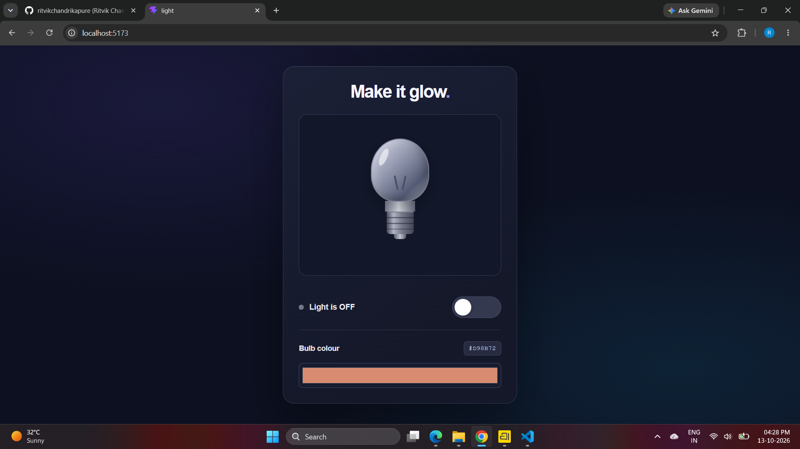
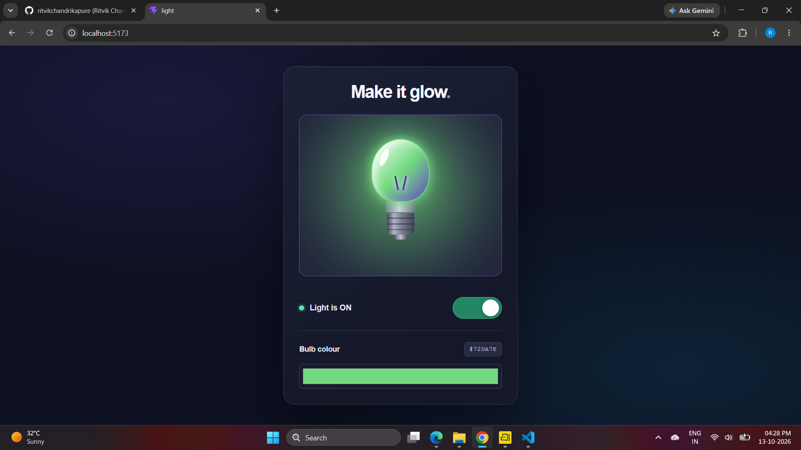
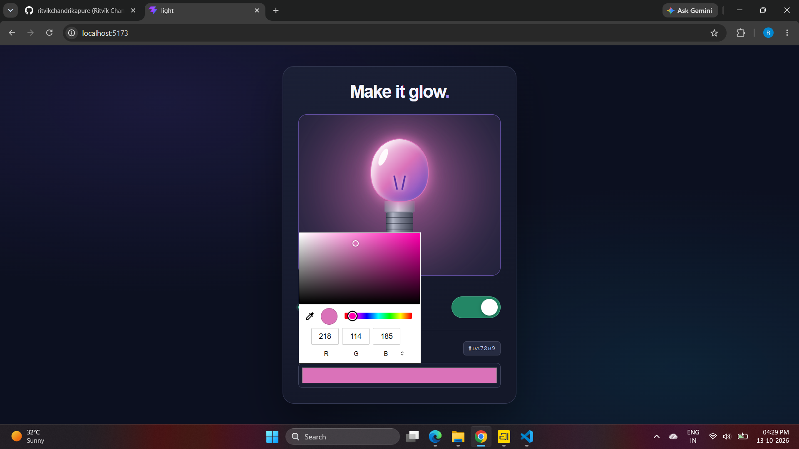

# Make It Glow — Interactive Light Bulb

A small interactive light-bulb project built with **React**, **Vite**, and **CSS**. Switch the bulb on or off and use the colour picker to change its glow.

## Screenshots

### 1. Light switched off


### 2. Light switched on


### 3. Custom bulb colour and glow


## Features

- Toggle the light **ON** and **OFF**.
- Choose a custom bulb colour using the colour picker.
- Show a matching glow when the light is switched on.
- Display the selected colour as a hexadecimal value.
- Update the bulb appearance as the colour changes.
- Simple, responsive interface.

## Tech Stack

- React
- Vite
- JavaScript / JSX
- CSS

## Run Locally

1. Open a terminal in this project folder.
2. Install dependencies:

   ```bash
   npm install
   ```

3. Start the development server:

   ```bash
   npm run dev
   ```

4. Open the local URL printed in the terminal, usually `http://localhost:5173`.

## Project Structure

```text
light/
├── src/
│   ├── assets/
│   ├── images/
│   │   ├── bulb1.png
│   │   ├── bulb2.png
│   │   └── bulb3.png
│   ├── App.jsx
│   ├── App.css
│   ├── index.css
│   └── main.jsx
├── public/
├── index.html
├── package.json
├── README.md
└── vite.config.js
```

## Screenshot Paths

The screenshots are stored in `src/images/`. Keep the filenames unchanged so the images display correctly in this README on GitHub.

---
Built with React and Vite.
